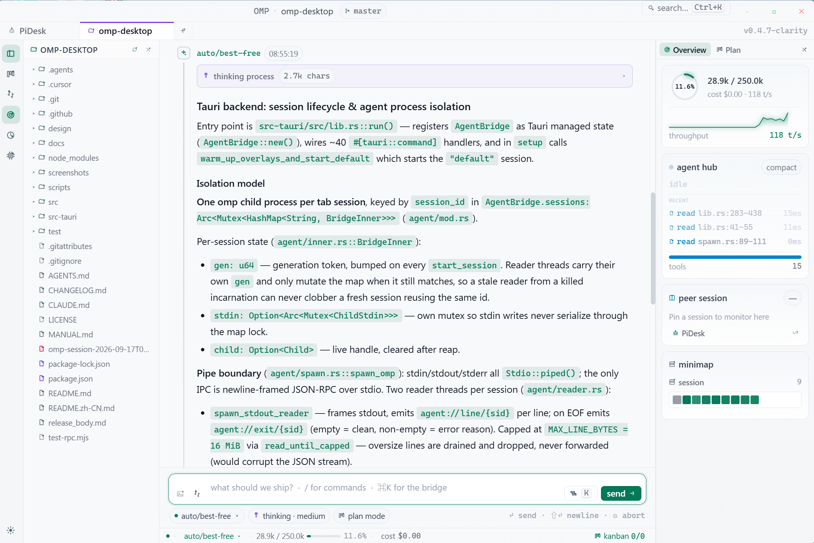
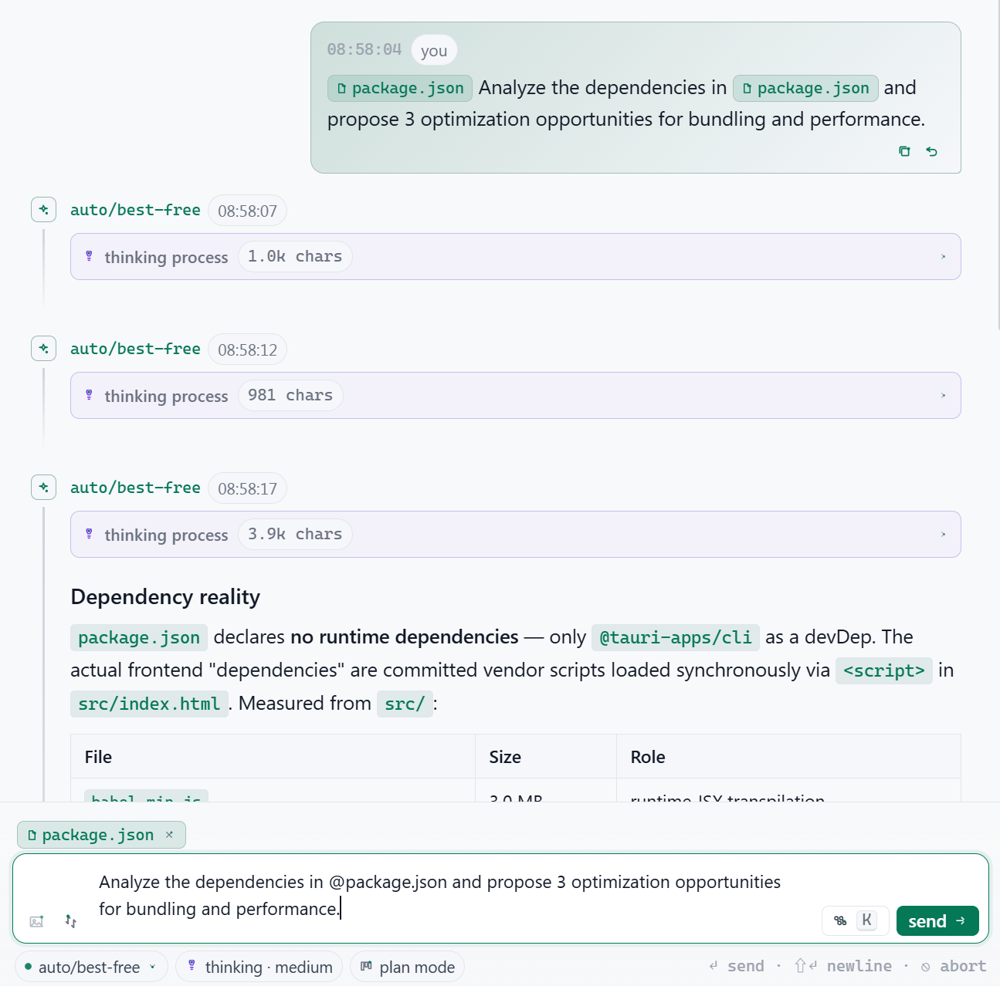
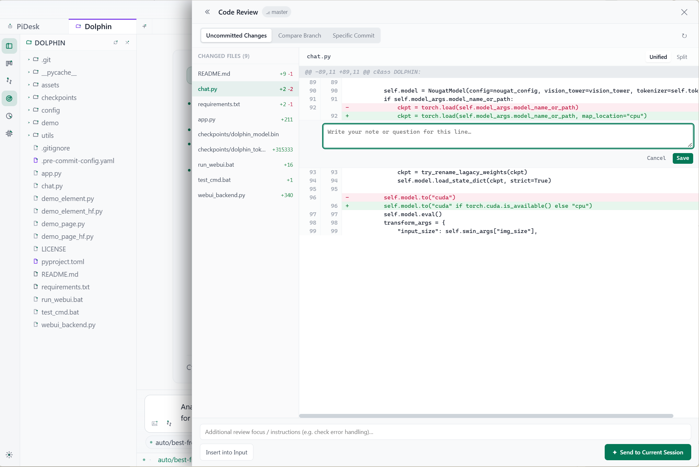
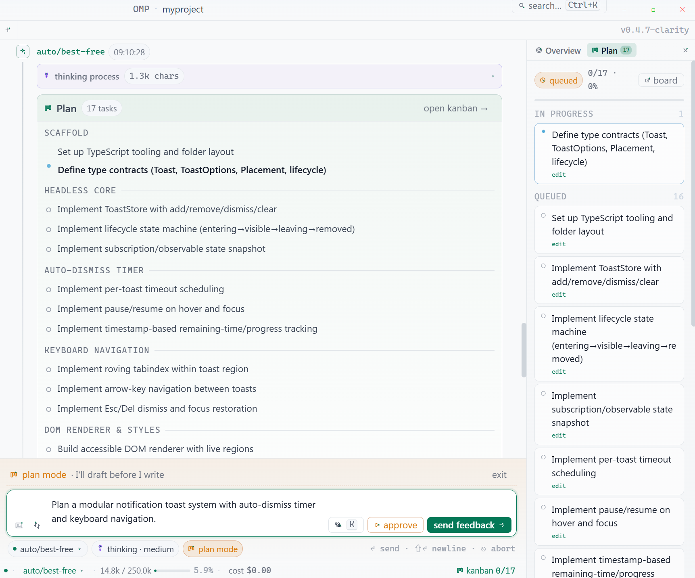
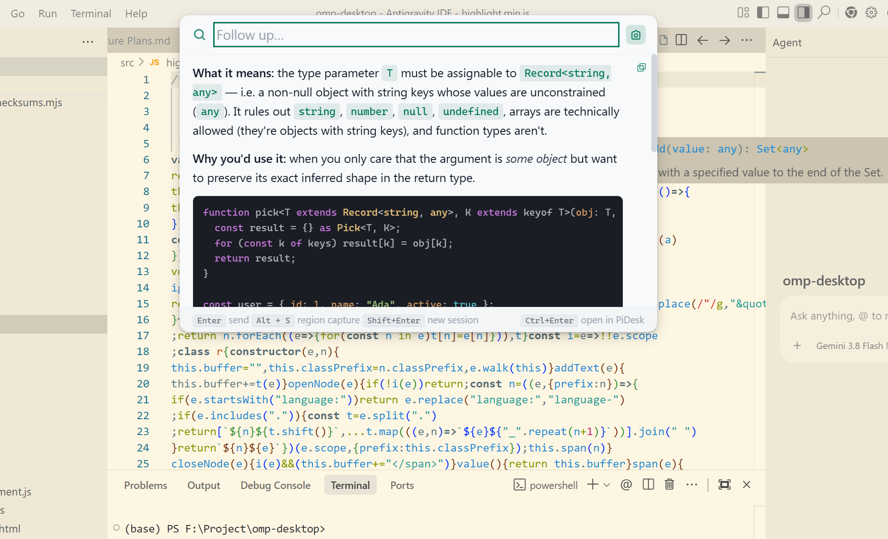
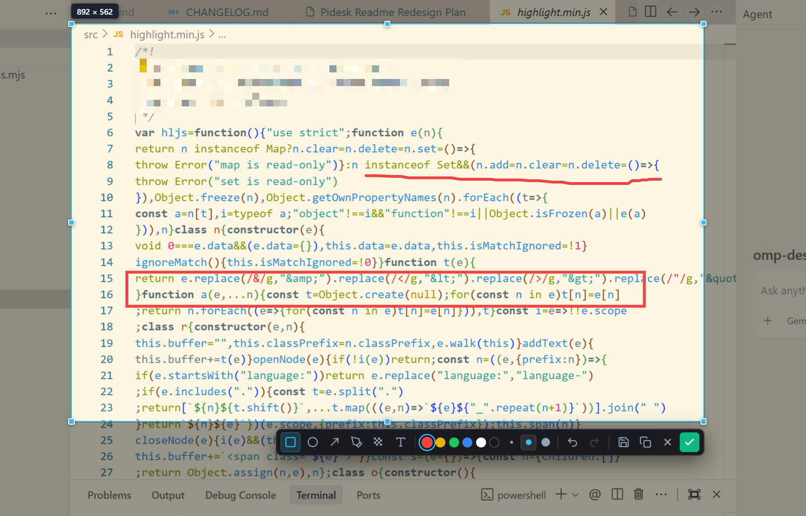
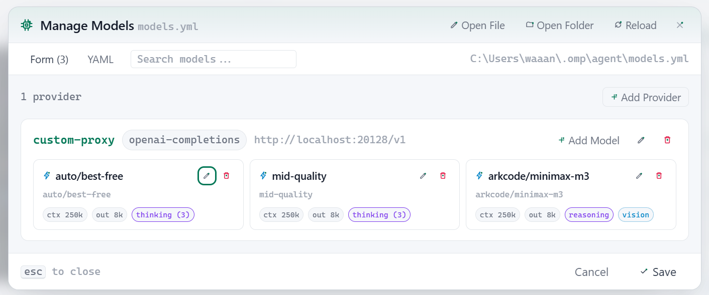
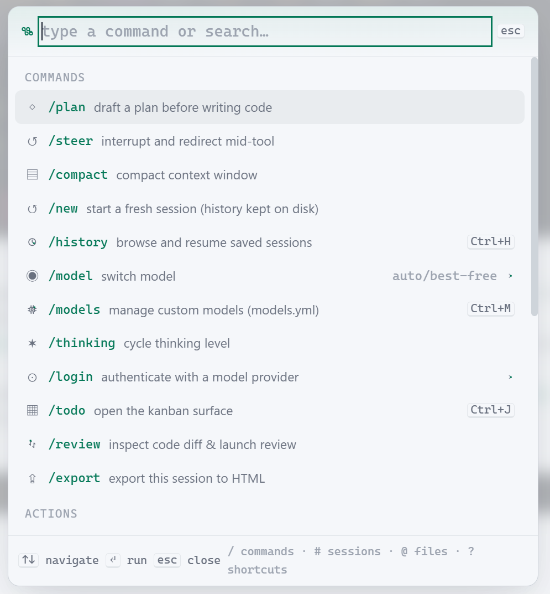

# PiDesk — oh-my-pi Desktop GUI

**The native desktop client for [oh-my-pi](https://github.com/can1357/oh-my-pi) (`omp`)**

**Languages:** [English](README.md) · [简体中文](README.zh-CN.md)

PiDesk is a fast, lightweight **omp desktop** app that wraps the `omp` (oh-my-pi) coding agent in a polished native GUI — no Electron, no browser, just a ~8 MB [Tauri 2](https://tauri.app/) binary with a real-time React interface.

> **Note**: PiDesk is an independent project evolved from [apoc/omp-desktop](https://github.com/apoc/omp-desktop).

---

## Why PiDesk?

| | |
|---|---|
| 🖥️ **Native feel** | Frameless window, custom title bar, system tray — no browser chrome |
| 🪶 **Tiny footprint** | ~8 MB binary (Tauri + Rust backend, zero Electron overhead) |
| 📡 **Offline ready** | No CDN dependencies, no external services required |
| 🗂️ **Multi-tab sessions** | Each tab is an isolated `omp` process with full state preservation |
| ⚡ **Quick Bar** | Global hotkey overlay — ask the AI agent without leaving your workflow |
| 🎨 **Customisable UI** | Themes, density, font size, accent colours — all adjustable at runtime |



---

## Features

### 🖥️ Modern Multi-Panel Workspace
PiDesk introduces a sleek, distraction-free IDE-like layout engineered specifically for AI-assisted coding:
- **Left Activity Bar**: Single 44px entry strip for instant access to Files (`Ctrl+B` / `⌘B`), Plan (`Ctrl+J` / `⌘J`), Code Review, Overview, History (`Ctrl+H` / `⌘H`), and Models (`Ctrl+M` / `⌘M`).
- **Interactive File Explorer**: Full directory tree with file watcher sync, syntax icons, and right-click "Reference File" integration.
- **Dockable Right Panel**: Tabbed with live session `Overview` (Agent Hub, peer sessions, token minimap) and active `Plan`. Double-click border to reset width.
- **Recent Projects**: Tab bar `+` menu tracks your 10 most recent repositories for instantaneous 1-click switching.
- **Isolated Multi-Tab Sessions**: Each tab runs an isolated `omp --mode rpc` background process with full state and stream persistence.


---

### 💬 Context-Aware Chat & Precision Control
Interact with the coding agent with unprecedented control and clarity:
- **`@` File Mentions & Chips**: Type `@` anywhere in the composer to fuzzy-search project files and attach them as token-efficient reference chips.
- **Non-Destructive Message Undo**: Made a typo or steered off course? Click **Undo** on any user bubble to rollback agent execution via native branch RPC and return your exact prompt to the composer for editing.
- **Smart Tool Folding**: Long sequences of 3+ tool invocations automatically collapse into a tidy summary chip with duration and status counts.
- **Branch From Here**: Fork any point in the conversation history from assistant replies into an independent session tab.
- **Collapsible Reasoning**: Dedicated container for thinking process with live elapsed timer and token metrics.
- **Visual Token Heatmap**: Minimap grid providing instant bird's-eye overview of 200+ conversation turns with click-to-scroll.



---

### 🔍 Interactive Code Review Drawer (`/review`)
Review code modifications side-by-side with your agent without ever opening a separate Git GUI:
- **Comprehensive Diff Target Selection**: Inspect uncommitted working directory changes, base branch comparisons (PR style), or specific commits.
- **Split & Unified Views**: Toggle side-by-side split diff or unified view; click the header toggle to expand the drawer to full window width.
- **Human-in-the-Loop Line Annotations**: Click `+` on any code line to attach inline comments, change requests, or review questions.
- **Direct Agent Feedback**: Click "Send to Session" to compile all inline notes and diff context into a structured steering prompt for the agent.



---

### 📋 Plan Mode & Dynamic Kanban Board
Enforce a disciplined *draft-before-write* workflow for complex tasks:
- **Draft & Iterate**: First prompt is framed into a planning phase where the agent drafts architecture without touching files.
- **Inline Paragraph Annotations**: Click on any paragraph of the agent's proposed plan to leave targeted feedback.
- **Approval Transition**: Approving the plan submits all feedback and seamlessly kicks off execution.
- **Real-Time Kanban Tracking**: Watch the agent automatically populate and advance tasks across Backlog, In Progress, and Done boards via `todo_write`.



---

### ⚡ Spotlight Quick Bar & System Tray
Ask questions and solve problems without disrupting your active workflow:
- **Global Hotkey (`Ctrl+Shift+Space` / `⌘⇧Space`)**: Instant floating overlay with seamless backdrop blur.
- **Sticky-Bottom Streaming**: AI responses stream in real-time with automatic bottom pinning (pauses smoothly if you scroll up).
- **Screen Context Auto-Capture**: Toggle the camera button to send full-screen or cropped screenshots along with your question.
- **Session Routing**: Press `Enter` to ask follow-up questions in the active session, or `Shift+Enter` to launch an isolated inquiry.
- **Copy as Markdown**: Top-right copy action writes raw Markdown output directly to the clipboard.



---

### ✂️ Screen Capture & Privacy Annotation Suite
Built-in high-DPI screenshot utility designed for sharing bug reports and visual prompts:
- **Two-Stage Region Selection**: Press `Alt+S` (macOS `⌥S`) to freeze the display; drag to frame and adjust freely using 8-direction handles.
- **Professional Annotation Suite**: Crisp swallowtail notched arrows, bounding rectangles, ellipses, freehand brush, and text labels.
- **Mosaic Blur (Redaction)**: Locally pixel-average sensitive tokens, passwords, and private API keys before sending to AI.
- **Multi-Channel Export**: Send directly to composer (`Enter`), copy to clipboard (`Ctrl+C`), or save to disk as PNG/JPEG (`Ctrl+S`).



---

### 🧠 Model Manager & Dynamic Reasoning Effort
Take full advantage of modern reasoning and frontier AI models:
- **OAuth Providers**: Authenticate Cursor, Anthropic, OpenAI Codex, or GitHub Copilot with `omp login <provider>` — all available models sync automatically.
- **Custom Endpoints**: Connect any OpenAI-compatible, Anthropic, or Gemini endpoint (DeepSeek, OpenRouter, SiliconFlow, Ollama, vLLM, LM Studio).
- **Configurable Thinking Effort**: Customize multi-level reasoning depth per model (e.g. Claude 6-level thinking, DeepSeek dual-level, or OpenAI effort sequences) with live status bar cycling and instant hot-reload.



---

### 🎨 Command Palette & Modern Aesthetics
- **Command Palette (`Ctrl+K` / `⌘K`)**: Fast fuzzy launcher across slash commands (`/`), saved sessions (`#`), project files (`@`), and shortcut cheatsheet (`?`).
- **4 Curated Themes**: Dark modes (**Aurora**, **Phosphor**) and light modes (**Daylight**, and the modern cool-gray **Clarity**).
- **High-Contrast Palette**: 8 meticulously chosen accent colors meeting WCAG AA contrast standards (>= 4.5:1).



---

## Installation

### macOS

#### Option A: Homebrew Cask (Recommended)

Installs the app and automatically handles Gatekeeper quarantine:

```bash
brew install --cask raiderwang/tap/pidesk
```

To update later:
```bash
brew upgrade --cask pidesk
```

#### Option B: Manual Download (.dmg)

1. Download the latest `.dmg` from [GitHub Releases](https://github.com/RaiderWang/pidesk/releases) (`aarch64` for Apple Silicon, `x64` for Intel).
2. Open the disk image and drag **PiDesk.app** to your `/Applications` folder.
3. **If macOS reports "PiDesk is damaged and can't be opened"**:  
   This is macOS Gatekeeper blocking downloaded unsigned binaries via quarantine flags. Run this command once in your terminal to clear the quarantine attribute:
   ```bash
   xattr -cr /Applications/PiDesk.app
   ```

### Windows

Download the `.msi` (recommended) or `.exe` installer from [GitHub Releases](https://github.com/RaiderWang/pidesk/releases).  
*If Windows SmartScreen prompts on first run, click **More info → Run anyway**.*

### Linux

Download `.AppImage` or `.deb` from [GitHub Releases](https://github.com/RaiderWang/pidesk/releases).

---

## Requirements

| Tool | Version |
|------|---------|
| [Rust](https://rustup.rs/) | stable (1.77+) |
| [Node.js](https://nodejs.org/) | 18+ |
| [Tauri CLI](https://tauri.app/start/prerequisites/) | 2.x (`npm install`) |
| [oh-my-pi](https://github.com/can1357/oh-my-pi) | 14.8+ (`omp` in PATH) |

`omp` must be reachable as `omp` on your `PATH`. On Windows it is typically
installed at `%LOCALAPPDATA%\omp\omp.exe` and added to PATH by the installer.

---

## Getting Started

```bash
# Clone
git clone https://github.com/RaiderWang/pidesk.git
cd pidesk

# Install Tauri CLI (dev dependency only)
npm install

# Dev mode — hot-reloads frontend, rebuilds Rust on backend changes
npm run dev

# Production build
npm run build
```

Dev mode auto-opens the WebView DevTools in debug builds.

---

## UI Customisation (Tweaks)

Open the Tweaks panel (gear icon at the bottom of the Activity Bar or `Ctrl+,` / `⌘,`) to adjust:

| Setting | Options |
|---------|---------|
| Language | English · 简体中文 (instant live switch, persisted locally) |
| Theme | aurora · phosphor · daylight · clarity |
| Density | cozy · compact · dense |
| Accent colour | 8 presets + custom |
| Mono chat font | toggle |
| Font size | 75% – 150% slider |
| Layout | rail · split · focus |

---

## For Developers

- **`test-rpc.mjs`** — Standalone Node/Bun script that exercises the `omp --mode rpc` protocol without the full UI
- **Stack**: Tauri 2 (Rust) + React 18 (in-browser Babel, no bundler) + `omp --mode rpc` child process per tab
- **Strict CSP**; asset protocol disabled; no shell plugin surface; no CDN dependencies
- See [manual.md](manual.md) for architecture, RPC protocol, Tauri commands, frontend state flow, and design decisions
- See [CLAUDE.md](CLAUDE.md) for module layout and contribution guidelines

---

## License & Attribution

PiDesk is open source under the [MIT License](LICENSE).  
Original work Copyright (c) 2026 Miroslav Drbal ([apoc/omp-desktop](https://github.com/apoc/omp-desktop)).  
Modifications and enhancements Copyright (c) 2026 Rick Wang.
